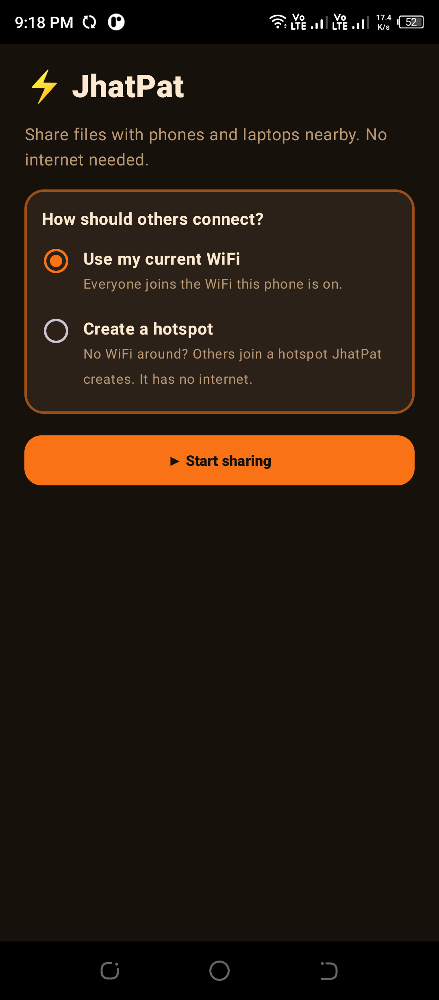
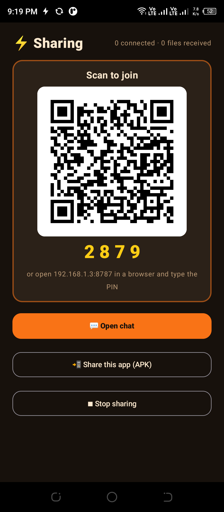
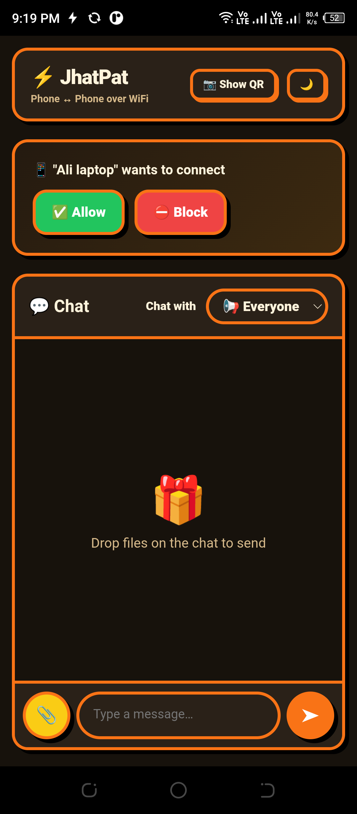

<div align="center">

# JhatPat ⚡

**Send files between phones and laptops over WiFi. Scan a QR code, no internet, no cloud.**

[](https://github.com/Hamza-Bhai/jhatpat/actions/workflows/ci.yml)
[](https://github.com/Hamza-Bhai/jhatpat/releases/latest)
[](LICENSE)

[**Download for laptop**](https://github.com/Hamza-Bhai/jhatpat/releases/latest) ·
[**Download Android app (APK)**](https://github.com/Hamza-Bhai/jhatpat/releases/latest) ·
[Report a bug](https://github.com/Hamza-Bhai/jhatpat/issues/new/choose) ·
[Hire the author](#built-by-hamza)

</div>

<p align="center">
  
  &nbsp;
  
  &nbsp;
  
</p>

JhatPat turns a laptop **or an Android phone** into a small private file server on your WiFi. The other person opens it in their browser, scans a QR code and can send photos, videos, documents, folders, text and links in both directions. Nothing goes to the internet, so it is fast and private.

There are two ways to run it. Both give everyone the same page in their browser, so **people who join never install anything**.

| | **JhatPat for laptop** | **JhatPat for Android** |
|---|---|---|
| Who hosts | A Windows, macOS or Linux laptop | An Android phone |
| Install | Unzip and run, one small file | Install the APK |
| Network | Your WiFi | Your WiFi, or a hotspot the app creates |
| Good for | Phone to laptop transfers at home or work | No laptop around, or no WiFi at all |
| Jump to | [Laptop section](#jhatpat-for-laptop) | [Android section](#jhatpat-for-android) |

## How it works

```text
   Host (laptop or Android phone)  ◄──── same WiFi / hotspot ────►  Anyone's browser
   runs JhatPat, shows a QR code                                     scans the QR, owner taps Allow
```

1. The host starts JhatPat and shows a QR code (and a 4-digit PIN).
2. Another device scans the code, or opens the address and types the PIN.
3. The host taps **Allow**. Every device is asked again on every run.
4. Send files, folders and text to one device, a group (like "Family"), or everyone.

## Features

- 📱 **Nothing to install for guests.** Android, iPhone and laptops just use the browser.
- 🔁 **Both directions**, many files at once, with resume if the WiFi drops mid-upload.
- 📁 **Folders.** Host → guest as a ZIP; guest → host with the folder structure kept (Android and desktop browsers).
- 💬 **Text and links**, with a one-tap Copy button.
- 🔐 **PIN or QR, plus approval.** Wrong PINs are rate-limited. A blocked device can be unblocked later.
- 👨‍👩‍👧 **Groups and privacy.** A device can never see items that were not sent to it.
- 🖼️ **Previews.** Photos, videos, audio and PDFs open full screen, also for files saved to the phone's Gallery.
- 🌞/🌙 **Light and dark** themes.

---

## JhatPat for laptop

Runs on **Windows, macOS and Linux**. One small file, nothing else to install.

### Quick start

1. Download JhatPat for your system from the [Releases](../../releases/latest) page and unzip it.
2. Run `jhatpat` (on Windows, double-click `jhatpat.exe`; no terminal window opens).
   - Windows may show **"Windows protected your PC"** because the app is not code-signed. Click **More info → Run anyway**.
   - If Windows Firewall asks, click **Allow access** (tick *Private networks*).
3. The JhatPat page opens in your laptop's browser.
4. Connect your phone to the **same WiFi**, then scan the QR code with the phone camera.
5. Tap **✅ Allow** on the laptop. Done, send away! 🎉

Received files are saved to `Downloads/JhatPat`. To stop JhatPat, click **Quit JhatPat** at the top of the page (or press `Ctrl+C` if you started it from a terminal).

### Network Doctor

If a phone cannot connect, click the status pill at the top of the laptop page. The **Network Doctor** says in plain words what is wrong (Public network, firewall, VPN adapter, router isolation) and how to fix it.

| Problem | Fix |
|---|---|
| Phone can't open the link, Doctor says **Public network** | Windows blocks phones on Public networks. *Settings → Network & Internet → Wi-Fi → your network → Network profile type → **Private***. |
| Doctor says **Firewall is blocking** | Click *Allow JhatPat (admin)* in the Doctor, or allow it when Windows asks. |
| Phone still can't connect | Your router may have **AP / client isolation** (common on guest and office WiFi). Turn it off in the router settings, or use a **hotspot**: turn on your phone's hotspot, connect the laptop to it, and scan the new QR. |
| Wrong address in the QR (VPN or virtual adapters) | Start with `jhatpat -ip <your WiFi address>`. |
| Slow transfers | Use **5 GHz** WiFi if your router has it. |

### Options

```text
jhatpat -port 8787          # port (tries the next ones if busy)
jhatpat -dir D:\Inbox       # where received files go
jhatpat -ip 192.168.1.5     # which network address to put in the QR code
jhatpat -no-browser         # don't open the laptop page automatically
jhatpat -version            # print the version
```

On Windows the released `jhatpat.exe` has no console, so it prints nothing; run a source build if you want terminal output.

---

## JhatPat for Android

The app turns a phone into the host, exactly like the laptop program. It bundles the same server, so you get the same chat page plus what a phone needs: a hotspot, sharing from other apps, saving to the Gallery and sharing the app itself.

### Install

1. Download `JhatPat-<version>.apk` from the [Releases](../../releases/latest) page and open it. Android asks you to allow **Install unknown apps** for your browser or file manager; allow it just for this install.
2. Releases are signed with the same key every time, so a newer APK installs over the old one and keeps your settings. The `.sha256` file next to each APK lets you check the download.
3. Needs **Android 8 or newer**.

### Use it

1. Open JhatPat and tap **Start sharing**.
   - **Use my current WiFi** if everyone is on the same network.
   - **Create a hotspot** if there is no WiFi. JhatPat makes a hotspot with no internet. Android needs the **Location** permission (and Location switched on) for this, once.
2. Show the QR code. With a hotspot there are two quick steps: first the QR that joins the WiFi, then (after you tap *They're connected*) the QR that opens JhatPat.
   - Some camera apps only show the text of a WiFi QR code. Scan it with **Google Lens** or with *Settings → WiFi → add network → scan icon*, or join by hand with the name and password shown under the QR.
3. Tap **Allow** in the chat when someone asks to join, then send files, folders and text to one person, a group or **Everyone**. Use **Show QR** in the chat header to get back to the QR code.

### What the app adds

- **Share from other apps.** In Gallery, Files or WhatsApp choose *Share → JhatPat* to send to the people connected.
- **Gallery-friendly.** Received photos and videos go to the Gallery and other files to Downloads, in a `JhatPat` folder. Previews still work in the chat.
- **Share this app.** A nearby person can install JhatPat from your phone, without internet, with the *Share this app* button.
- **Keeps working with the screen off.** A notification shows how many people are connected and has a **Stop** button.

See [`JhatPat-app/`](JhatPat-app) to build the app yourself and [`JhatPat-app/DESIGN.md`](JhatPat-app/DESIGN.md) for how it works.

---

## Security and privacy

- JhatPat only works on your local network and never contacts the internet. There is no account, no cloud and no tracking.
- Joining needs the QR secret or the PIN **and** the owner's approval. Wrong PINs are rate-limited.
- The host page only opens on the host device itself and needs a per-run token.
- Traffic uses plain **HTTP** on your WiFi (browsers show scary warnings for self-signed HTTPS on phones). Someone on the same WiFi with special tools could see files in transit, so use JhatPat on networks you trust.
- To report a vulnerability, please follow [SECURITY.md](SECURITY.md).

## Build from source

**Laptop version** needs Go 1.24 or newer:

```bash
git clone https://github.com/Hamza-Bhai/jhatpat
cd jhatpat/web
go test ./...
go build -o jhatpat ./cmd/jhatpat
# Windows, no terminal window on double-click: run build-windows.bat (uses -ldflags "-H=windowsgui")
```

**Android app** needs JDK 17, the Android SDK (platform 35) and Go, because the build packs the server into the APK:

```bash
cd jhatpat/JhatPat-app
./gradlew testDebugUnitTest assembleDebug
```

More in [`JhatPat-app/README.md`](JhatPat-app/README.md).

## Repository layout

| Folder | What it is |
|---|---|
| [`web/`](web) | The JhatPat server and web interface (Go). Runs on Windows, macOS and Linux. |
| [`JhatPat-app/`](JhatPat-app) | The Android app (Kotlin, Jetpack Compose) that runs the same server on a phone. |
| [`docs/`](docs) | Manual testing checklist and README images. |

## Contributing

Issues and pull requests are welcome. Please read [CONTRIBUTING.md](CONTRIBUTING.md) first. The history of changes is in [CHANGELOG.md](CHANGELOG.md).

## License

[MIT](LICENSE). Free to use, change and share.

---

## Built by Hamza

JhatPat is an independent open-source project by **Hamza**. If you like it, a ⭐ on the repository helps a lot.

**Need something built?** I take on custom software work. If you have a product idea or a business problem, get in touch. Typical projects:

- 📱 **Android apps** (Kotlin, Jetpack Compose)
- 🌐 **Web apps and websites**
- 🧩 **Odoo** development, customization and integrations
- ⚙️ **Automation, backend services and command-line tools** (Go and more)
- 💻 **Desktop tools** for Windows, macOS and Linux

📧 **Email:** [hamzapervaiz276@gmail.com](mailto:hamzapervaiz276@gmail.com?subject=Project%20inquiry%20%28from%20JhatPat%29)
